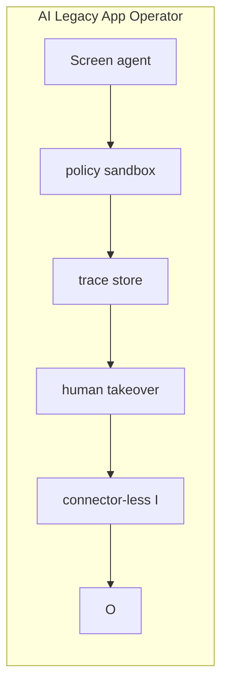

# AI Legacy App Operator

  

> An operator that uses existing enterprise GUIs instead of waiting for APIs.

**Repository:** [https://github.com/AIFrontiersLab/AILegacy](https://github.com/AIFrontiersLab/AILegacy)

---

## Why this exists

Most valuable software still has no complete API; work remains trapped in screens.

**Why now:** Computer-use models became good enough to drive real GUIs with supervision.

**What recently changed:** Multimodal computer-use agents and cheaper runtime.

**Why it was hard before:** RPA was brittle; models could not see and reason about screens.

---

## Product thesis

| | |
|---|---|
| **Future thesis** | The next integration layer is an operator, not another iPaaS connector. |
| **First customer** | A shared-services team running a repetitive GUI workflow daily |
| **Market** | Enterprise operations |
| **Convergence** | Computer Use, Authorization, Persistent Memory |
| **Moat** | Process graphs learned from real operator traces. |

---

## MVP

A supervised operator for one high-value legacy workflow with replayable traces.

### Core loop

1. Accept an agent (or human-on-behalf-of-agent) intent
2. Enforce scope / policy / evidence
3. Execute the smallest useful autonomous step
4. Leave an audit trail a human can kill-switch

---

## Architecture

```text
Screen agent, policy sandbox, trace store, human takeover, connector-less I/O.
```



---

## Start

```bash
python3 -m http.server 4173 --directory .
```

---

## Why it may win

API coverage of legacy systems will stay incomplete for a decade.

## Why it may fail

Error rates make it a demo forever.

### Risks

- Incumbent RPA vendors add a model

### Unknowns

- Reliability at production SLAs

### Current alternatives

- UiPath
- human shared-services teams
- custom APIs that never ship

### Assumptions

- Agent workflows will keep expanding into real systems

---

## Scope

This project is intentionally scoped to **AI and Agentic AI** only.

---

## Tags

`ai` `agentic-ai` `autonomous-agents` `nocta` `prototype` `computer-use` `authorization` `persistent-memory`
